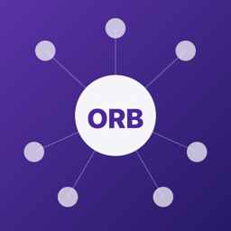
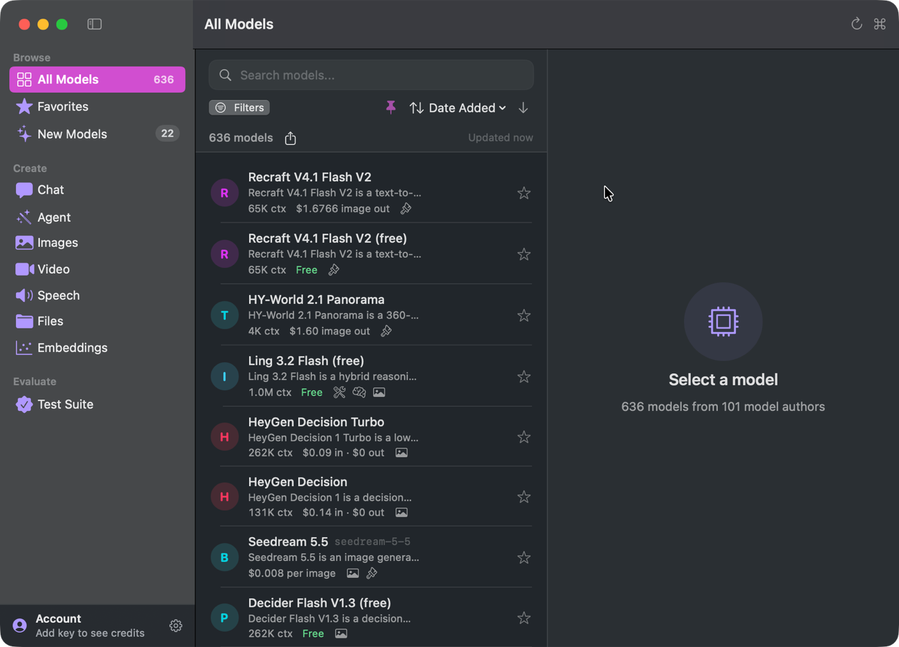
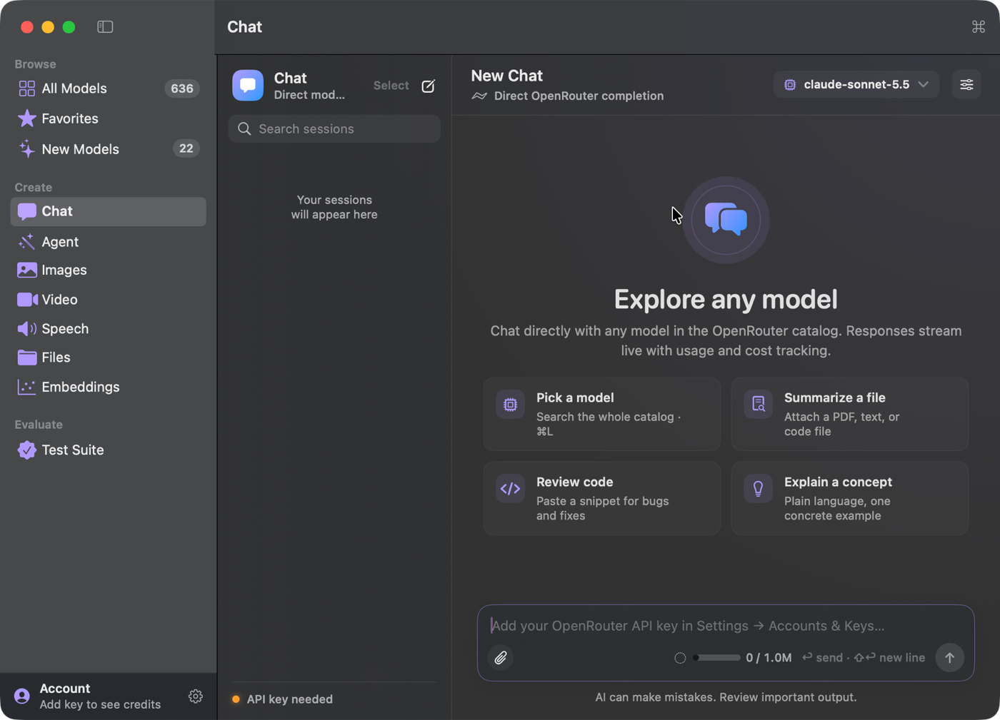
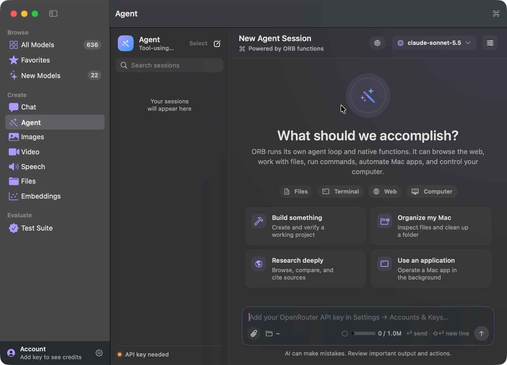
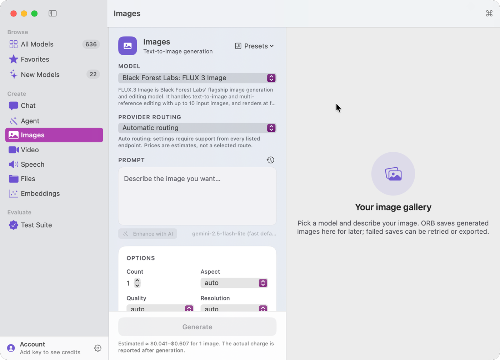
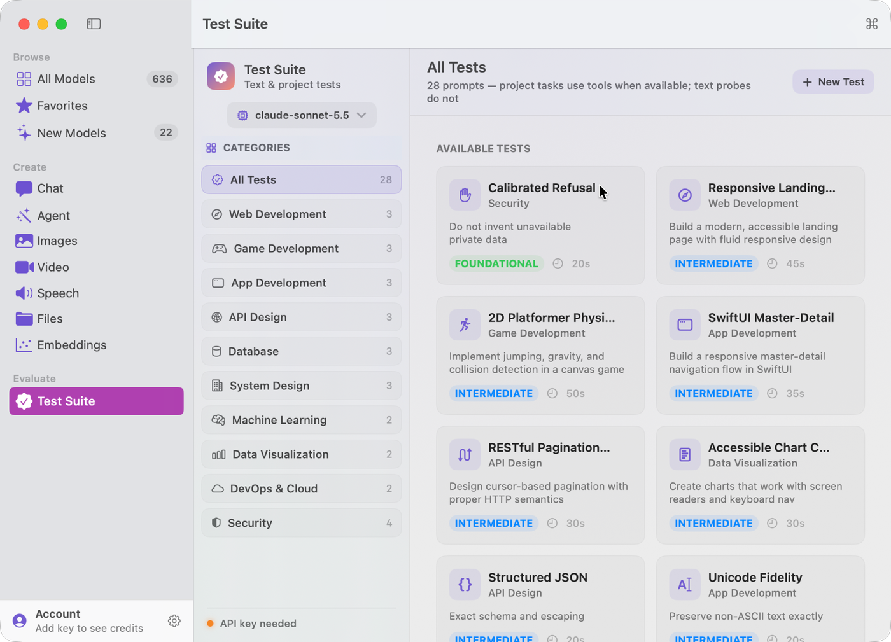

<p align="center">
  
</p>

<h1 align="center">ORB</h1>

<p align="center">
  <strong>OpenRouter Browser</strong>: a native macOS app for finding, comparing, chatting with, and building on the models available through <a href="https://openrouter.ai">OpenRouter</a>.
</p>

<p align="center">
  <a href="https://github.com/Eplisium/orb/actions/workflows/ci.yml"></a>
  
  
  
  <a href="LICENSE"></a>
</p>

<p align="center">
  Built with SwiftUI and Swift Package Manager. No Xcode project is needed.
</p>

---

## Screenshots


| Browse | Chat |
|---|---|
|  |  |
| **Agent** | **Generate studio** |
|  |  |
| **Test Suite** | |
|  | |

## Features

- **Browse every OpenRouter model.** Search the public catalog, filter by modality and capability, sort by price, context, release date, or benchmark scores, and compare models side by side. Each model shows pricing, supported parameters, benchmarks, and its per-provider endpoints (uptime, quantization, and latency and throughput where OpenRouter reports them). Favorites and notes stay on your Mac. No API key needed.
- **Chat with any model.** Responses stream as rendered Markdown with code, tables, and reasoning shown inline. Attach images and files, tune temperature, reasoning effort, and provider routing, and watch tokens, cost, and context use live. Sessions can be searched, pinned, branched, and exported.
- **Run a native agent.** ORB drives its own tool loop against OpenRouter: web search and fetch, files in a workspace you choose, shell commands, AppleScript, screenshots, and mouse and keyboard control. It starts in Web Only mode; risky tools ask for your approval, and every call shows up as a card in the transcript.
- **Connect MCP servers.** Add local stdio Model Context Protocol servers or import a standard `mcpServers` JSON file. Their tools, resources, and prompts become available to the Agent, and secret environment variables can be stored in the Keychain.
- **Generate media.** Separate studios for images, video (jobs resume after a relaunch without being submitted again), speech and transcription, embeddings and reranking, plus your uploaded OpenRouter files. Results land in a shared Library with search, Quick Look, export, and Undo.
- **Compare models with the Test Suite.** Run built-in project tasks and text probes across models. A project only passes when its files check out; plain text answers are marked "unverified", never passed. Paid comparison runs need your model picks and a dollar ceiling.
- **Know what you spend.** Credits and activity (with an optional management key), plus a local usage and cost ledger with charts in Settings.
- **Feels like a Mac app.** Command palette, keyboard shortcuts, light and dark themes with accent colors, adjustable text size, Reduce Motion support, and a Touch ID or password app lock (on by default).

## Install

### Download

Get the latest `ORB-<version>.zip` from the [Releases page](https://github.com/Eplisium/orb/releases). Each release also has a `SHA256SUMS` file (`shasum -a 256 -c SHA256SUMS`).

ORB is ad-hoc signed, not notarized, so the first launch needs one extra step:

1. Unzip it and move `ORB.app` to `/Applications`.
2. **Right-click → Open**, then confirm **Open**. (Double-clicking won't offer this the first time.) On recent macOS versions you may need **System Settings → Privacy & Security → Open Anyway** instead.

macOS treats each ad-hoc signed build as a different app, so expect Keychain and privacy prompts again after you update.

Every CI run on `main` also uploads an untagged build as the **ORB-adhoc-&lt;sha&gt;** artifact on the [Actions page](https://github.com/Eplisium/orb/actions/workflows/ci.yml) (GitHub sign-in required; kept for 14 days).

You need an [OpenRouter API key](https://openrouter.ai/settings/keys) for Chat, Agent, and Generate. The model browser works without one.

### Build from source

Requirements: macOS 14 Sonoma or newer and Swift 5.9 or newer (Command Line Tools or Xcode).

```bash
git clone https://github.com/Eplisium/orb.git
cd orb
swift build -c release
bash build_app.sh --adhoc
open ORB.app
```

`build_app.sh` packages the optimized release binary into `ORB.app`. It reads the version from [`VERSION`](VERSION), sets the build number to the git commit count, copies the committed icon from `Resources/AppIcon.icns`, writes `Info.plist`, and signs the bundle.

| Option | Effect |
|---|---|
| `--release` / `CONFIG=release` | Package the optimized release build (the default; run `swift build -c release` first, or add `--build`) |
| `--debug` / `CONFIG=debug` | Package the unoptimized debug build instead (run `swift build` first) |
| `--build` | Run `swift build` for the chosen configuration first |
| `--adhoc` | Ad-hoc signature (`codesign -s -`). Always used when `$CI` is set |
| `--output DIR` | Write the bundle somewhere other than the repository root |

Without `--adhoc`, the script creates a stable self-signed identity (kept in the git-ignored `codesign/` directory and added to your login keychain) and signs with [`rcodesign`](https://github.com/indygreg/apple-platform-rs) if it is installed. Because the identity stays the same across rebuilds, Keychain access and privacy grants survive local rebuilds.

## Security model

ORB holds credentials and can run tools with your user account's permissions. Read this section before you enable Computer Access.

- **Two credential roles.** The **inference key** is used for Chat, Agent, and Generate. The optional **management key** is used only for account-wide reads: credits, activity, and management inventory. Each key is stored in its own Keychain item and is never sent to an endpoint meant for the other role. Account features make no network request at all if the management key is missing. Keys are never written to preferences or logs, and API error messages are redacted before they are shown.
- **Computer Access = your permissions.** The Agent runs Web Only by default: web tools, memory, and planning only. No files, shell, computer control, or MCP tools. When you turn on Computer Access, native tools run as *you*. They can read and write files, run shell commands, automate apps, capture the screen, and send input. One deny-by-default policy controls both which tools are offered to the model and which calls are allowed to execute, and unknown tool names are always refused.
- **A workspace is not a sandbox.** The workspace folder limits ORB's own file tools (path traversal, `~`, and symlink escapes are rejected). Shell commands can still reach anything your account can.
- **Approvals.** Terminal, computer-control, and MCP tool calls stop and wait for your approval. Missing approval infrastructure denies the call. If you deny or stop, the model receives a tool error. **OP Mode** (off by default, in Settings) explicitly skips prompts for Agent runs without granting extra capabilities. Test Suite project commands always require approval, even with OP Mode enabled; leaving Test Suite denies pending and subsequent prompts until you return. Approved shell commands are still not sandboxed.
- **MCP servers run as local subprocesses** with your permissions. Only add servers you trust. The tool policy offers or runs an MCP tool only if the session has the MCP capability *and* that specific server is approved. Every call also goes through the approval prompt. Secret references that can't be resolved stop the server from launching, so a placeholder value is never passed to it.
- **Media downloads.** Generated media from unsigned URLs is fetched without credentials. ORB only sends a bearer token to `https://openrouter.ai/api/…`.

To report a vulnerability, see [SECURITY.md](SECURITY.md).

## Architecture

ORB is a single SwiftPM executable target (`Sources/ORB`) plus one test target (`Tests/ORBTests`). Views and services are `@MainActor`, and MCP connections are actors. Streaming uses a `URLSessionDataDelegate` transport that passes each network chunk into an incremental SSE decoder, so tokens render as soon as they arrive. Persistence is SQLite in WAL mode under `~/Library/Application Support/ORB/`, with idempotent migrations and a fallback to a temporary in-memory database if the file can't be opened, is corrupt, or was written by a newer ORB. Generated assets are stored content-addressed (SHA-256) next to the database.

See [docs/ARCHITECTURE.md](docs/ARCHITECTURE.md) for the module map and data flow.

## Development

```bash
swift build --build-tests
swift test --skip-build --no-parallel       # full offline suite, as CI runs it
swift test --filter ToolPolicyTests         # one suite
bash scripts/count_warnings.sh build.log    # unique warnings in a saved build log
bash scripts/check_warnings.sh build.log    # fails if warnings exceed scripts/warnings-baseline.txt
```

Run the full suite with `--no-parallel`: several streaming tests measure wall-clock publish cadence and can fail when hundreds of tests compete for the CPU.

The test suite runs offline. It never reads your Keychain, never calls OpenRouter with a key, and isolates SQLite to temporary files. A few tests need explicit opt-in and show as **skipped** unless their environment variable is set:

| Variable | Test | Notes |
|---|---|---|
| `RUN_OPENROUTER_INTEGRATION=1` | Live agent round trip | Uses your saved key and **spends credits** |
| `ORB_STREAM_SNAPSHOT_DIR=<dir>` | Streaming presentation snapshots | Writes PNGs |
| `ORB_REASONING_SNAPSHOT=<file.png>` | Reasoning layout snapshot | Writes a PNG |
| `NODE_BINARY=<path>` | MCP live tests | Only needed if `node` isn't in a standard location |

Run the snapshot tests **on their own**, never together with the full suite. `ImageRenderer` blocks the main actor, which skews the streaming-timing tests:

```bash
ORB_STREAM_SNAPSHOT_DIR=/tmp/orb-snapshots swift test --filter StreamingPresentationSnapshotTests
ORB_REASONING_SNAPSHOT=/tmp/reasoning.png swift test --filter ReasoningPresentationTests
```

Strict concurrency checking (`StrictConcurrency=targeted`) is enabled as warnings in `Package.swift`. The package still builds in Swift 5 language mode.

### Continuous integration

[`.github/workflows/ci.yml`](.github/workflows/ci.yml) runs on pushes and pull requests to `main`, and can also be started manually. It runs on `macos-15` with the latest stable Xcode and caches `.build`. A newer push cancels an older run only on pull requests; every `main` commit gets its own result. The steps are:

1. A hygiene check that `Sources/` and `Tests/` contain no local tool-cache paths.
2. `swift build --build-tests`, a unique-warning count in the job summary, and a gate that fails if the count rises above [`scripts/warnings-baseline.txt`](scripts/warnings-baseline.txt).
3. `swift test --skip-build --no-parallel` (opt-in tests stay skipped; CI never sets the variables above).
4. `swift build -c release`, then `build_app.sh --release --adhoc`, a bundle check (`scripts/verify_bundle.sh`), and a zipped `ORB.app` artifact.
5. Build, test, and package logs are uploaded as an artifact, including when the run fails.

### Releases

[`.github/workflows/release.yml`](.github/workflows/release.yml) runs when a `v*` tag is pushed. It checks that the tag matches `VERSION`, runs the tests, builds and packages the release configuration, and publishes a GitHub Release with `ORB-<version>.zip`, `SHA256SUMS`, and that version's [CHANGELOG](CHANGELOG.md) section as the notes (`scripts/changelog_section.sh`). Tags with a suffix (`v1.2.0-beta.1`) become pre-releases.

```bash
# after updating VERSION and the CHANGELOG section on main
git tag -s v1.2.0 -m "ORB 1.2.0" && git push origin v1.2.0
```

## Known limitations

- Video-job recovery journals complete local snapshots before SQLite writes. Restart recovery and Retry never resubmit paid work. Changed durable records require an explicit local conflict decision rather than timestamp-based overwrites. If both SQLite and the journal fail, the UI identifies memory-only records that are lost on quit. Competing snapshots can be reviewed and explicitly resolved without quitting; corrupt journal inventories fail closed and need repair; this is not a remote-submission outbox or a hardware power-loss guarantee.
- Registered Libraries use SQLite as authority, with JSON as a retryable compatibility export. New managed roots reclaim provably unowned files after durable Undo/import holds expire; maintenance runs while Library is open and on its next open/save. Shared, attached and standalone assets remain protected. **Existing legacy roots still retain removed files:** registration cannot prove global ownership, and safe copy-and-activate migration is not yet implemented. Do not delete or relocate old roots/catalogs manually; bindings fail closed.

- Corruption recovery preserves observed database files as verified forensic copies and leaves originals in place. An incomplete backup is reported, not silently discarded. The session remains memory-only until storage is explicitly repaired; repeated launches can accumulate copies. This does not guarantee a transactionally consistent backup of concurrent writers.

- **Not notarized.** Downloaded builds are ad-hoc signed and need right-click → Open. Keychain and privacy prompts come back after each update.
- **MCP approval is per server, not per tool.** Enabling a server in Settings is its approval: its tools are offered to the Agent whenever Computer Access is on, and each call still prompts. There is no way to allow only some of a server's tools.
- **Agent permission levels.** The Agent UI only offers Web Only or Computer Access. Finer policy presets (workspace read, workspace write, terminal only) exist internally and are used by the Test Suite, but you can't choose them in the Agent.
- **Management features are read-only.** ORB can list keys, BYOK credentials, guardrails, workspaces, and similar inventory, but it can't create or rotate keys, change budgets, or assign guardrails.
- **Responses, Messages, and batch APIs.** Adapters exist and are contract-tested, but Chat and Agent use chat completions only, and batches have no UI. Batch item success requires an explicit 2xx response status and no item error; it does not validate endpoint-specific body contents.
- **Test Suite verdicts are deterministic.** There is no LLM-judge score and no way to record a human review. Text answers stay "unverified". The spend ceiling checks reported model and helper costs between model runs, not a hard provider budget. A single request can exceed it. Independently billed helpers are recorded separately in Usage without double counting. Any unpriced model or helper request makes the run total unknown and stops a budgeted batch; known subtotals remain visible.
- **Usage is best-effort accounting.** Successful ledger writes survive deleting conversations. Failed writes show a warning and can be retried in Settings → Usage; their original events are retained in memory only until ORB quits. Provider omissions remain unpriced, not $0.
- **Encrypted reasoning isn't shown.** Signed or encrypted reasoning blocks are preserved for tool continuation, including unexpected JSON field shapes and explicit nulls; only string text and summary fields are displayed.
- **No attribution referer.** ORB sends `X-OpenRouter-Title: ORB` but no `HTTP-Referer`.

## Contributing, changelog, license

- [CONTRIBUTING.md](CONTRIBUTING.md): setup, test expectations, commit style.
- [CHANGELOG.md](CHANGELOG.md): release notes.
- [SECURITY.md](SECURITY.md): how to report vulnerabilities.
- MIT licensed. See [LICENSE](LICENSE).
